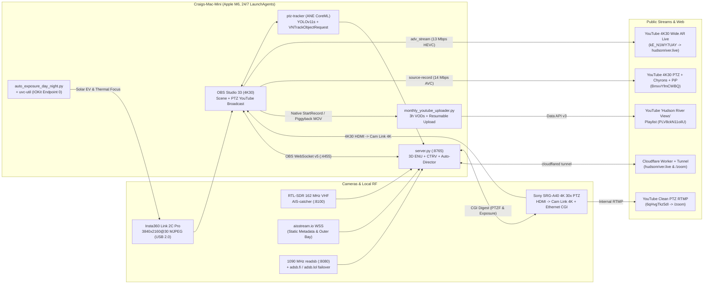

# Hudson River 24/7 4K AR Observatory & Autonomous 30× PTZ Director

A self-healing, zero-`pip`-dependency macOS broadcast, computer-vision, and astrophotography stack powering **[hudsonriver.live](https://hudsonriver.live)** and **[hudsonriver.live/zoom](https://hudsonriver.live/zoom)** from 17th Street in Manhattan overlooking Little Island, Lower Manhattan, Jersey City, Upper New York Bay, the Statue of Liberty, and the Verrazzano-Narrows Bridge.

The production host (`Craigs-Mac-Mini`, headless Apple M6 Mac mini) runs **three simultaneous 24/7 YouTube Live broadcasts** plus **automated multi-hour 4K VOD recordings & uploads** at **~4.3% CPU and 0.00% dropped/skipped frames**, combining a wide-angle 4K synoptic spotter camera, a 30× optical/Clear-Image-Zoom 4K PTZ camera, local 162 MHz VHF AIS + 1090 MHz ADS-B SDR receivers, and closed-loop Apple Neural Engine visual tracking.

---

## Table of Contents

1. [System Architecture & Live Streams](#1-system-architecture--live-streams)
2. [Zero-Overhead 4K Streaming & Recording in OBS](#2-zero-overhead-4k-streaming--recording-in-obs)
3. [Headless macOS & Capture Freeze Failure Modes (Solved)](#3-headless-macos--capture-freeze-failure-modes-solved)
4. [3D Geodesy, RF Sensor Fusion & PTZ Bore-Sight Kinematics](#4-3d-geodesy-rf-sensor-fusion--ptz-bore-sight-kinematics)
5. [Closed-Loop Apple Neural Engine Vision & Auto-Director](#5-closed-loop-apple-neural-engine-vision--auto-director)
6. [Exposure Engineering: Night, Day, Window Glare & Celestial](#6-exposure-engineering-night-day-window-glare--celestial)
7. [Through-Window Focus Architecture on Both Cameras](#7-through-window-focus-architecture-on-both-cameras)
8. [Autonomous 3-Hour Clear-Sky VOD Recorder & YouTube Uploader](#8-autonomous-3-hour-clear-sky-vod-recorder--youtube-uploader)
9. [Repository Map, LaunchAgents & Deployment Runbook](#9-repository-map-launchagents--deployment-runbook)

---

## 1. System Architecture & Live Streams



### Active Broadcasts & Playlists
- **Wide 4K30 Synoptic + AR HUD (`hudsonriver.live/`):** `https://www.youtube.com/watch?v=kE_N1WY7UAY` — OBS Program `"Scene"` (`Video Capture Device 2` + `/?hud=1` Browser Source).
- **4K30 30× PTZ + Broadcast Chyrons + Wide Overview Inset:** `https://www.youtube.com/watch?v=BmxvYfmCWBQ` — OBS `"PTZ YouTube Broadcast"` scene streamed independently via `exeldro/obs-source-record` (`3840×2160`: Layer 0 = Sony SRG-A40, Layer 1 = `896×504` Wide Overview PiP auto-hidden at `1×` zoom, Layer 2 = `static/ptz_yt_hud.html` lower-third chyron & live reticle).
- **Interactive Clean PTZ (`hudsonriver.live/zoom`):** `https://www.youtube.com/watch?v=6qHvgTkz5dI` (`unlisted`) — fed directly by the Sony SRG-A40's internal hardware RTMP encoder (monitored & auto-restarted every 60s by `ptz_maintenance_loop` in `server.py`), paired with public target click-to-slew & `Enhance!` controls over Cloudflare Tunnel.
- **Public Playlist ("Hudson River Views"):** `https://www.youtube.com/playlist?list=PLV8ckN11oilU` (`YT_HUDSON_PLAYLIST_ID`), containing all live broadcasts and automatically receiving every newly uploaded 4K VOD.

---

## 2. Zero-Overhead 4K Streaming & Recording in OBS

One of the most important hardware discoveries on this project is how **Apple Silicon's hardware VideoToolbox Media Engine** and **OBS's OpenGL/Metal pipeline** scale across multiple 4K30 outputs:

### The 2× 4K30 Hardware VideoToolbox Ceiling
- On a consumer Apple Silicon chip (Apple M6, 12 CPU cores), the hardware Media Engine comfortably sustains **two simultaneous `3840×2160 @ 30 fps` low-latency CBR hardware encode sessions (`~60 fps` aggregate 4K)** with **`0.00%` skipped frames and `~4.3%` CPU usage**:
  1. **Encoder #1 (`adv_stream`):** OBS's main 4K30 HEVC (`com.apple.videotoolbox.videoencoder.ave.hevc`, `13,000 kbps`, `DynamicBitrate=true`) feeding the wide synoptic stream.
  2. **Encoder #2 (`PTZ YouTube Stream`):** A single `source_record_filter` on `"PTZ YouTube Broadcast"` (`com.apple.videotoolbox.videoencoder.ave.avc`, `14,000 kbps`) feeding the 4K30 PTZ + Chyron broadcast.
- **What breaks if you add a 3rd 4K encoder / 2nd `source-record` filter:** Adding a second 4K `source_record_filter` pushes aggregate 4K demand to `90 fps` *and* triggers two simultaneous `3840×2160` OpenGL `gs_stagesurface_map` (`glReadPixels`) GPU→CPU texture readbacks inside OBS's graphics thread. That immediately causes **`34%–47%` skipped frames due to encoding lag**, starving **both** YouTube live streams (`videoIngestionStarved`).

### How We Record 4K30 VODs at 0.00% Extra Cost
Instead of spinning up extra encoders, **both** cameras record by piggybacking on the already-running live stream encoders:
1. **3-Hour Wide Synoptic Recordings (`OBSCameraBridge.start_synoptic_recording`):**
   - Uses OBS's native `StartRecord` / `StopRecord` with `[AdvOut] RecEncoder=none` (**"Use stream encoder"**) and `RecFormat2=hybrid_mov`.
   - OBS writes the **already-encoded 4K30 HEVC packets** from `adv_stream` straight to `/Users/craignm/Library/Caches/HudsonRiverMonthly/hudson_<YYYY-MM>_<slot>_*.mov`.
   - Verified over full 3-hour (`330,381`-frame, `16.5 GB`) captures with **`0` skipped render frames and `0` skipped output frames**.
2. **PTZ Camera Recordings (`OBSCameraBridge.start_ptz_recording`):**
   - Calls `SetSourceFilterSettings(..., overlay=True)` with `{"record_mode": 1, "path": ..., "filename_formatting": ..., "rec_format": "hybrid_mov"}` directly on the **existing** `PTZ YouTube Stream` `source_record_filter`.
   - `source-record` attaches a `mov` muxer to its **already-active** hardware encoder without interrupting the live RTMPS stream and finalizes the trailer in `~1 ms` when `record_mode` returns to `0`.
   - Note: `sync_ptz_youtube_filter()` in `obs_camera_bridge.py` intentionally omits `"record_mode": 0` when updating an existing filter so server restarts never clobber an in-progress piggyback PTZ recording.

### Network Interface Priority on `Craigs-Mac-Mini`
- **Always keep `Wi-Fi` (`en1`) ordered #1 ahead of `Ethernet` (`en0`)** in `networksetup -listnetworkserviceorder` on `Craigs-Mac-Mini`! The Ethernet port on that machine sits behind a slow link, whereas Wi-Fi (`en1`) easily handles simultaneous `27 Mbps` live 4K streaming + `170+ Mbps` (`~20 MB/s`) YouTube resumable VOD uploads with `outputCongestion: 0.0`.

---

## 3. Headless macOS & Capture Freeze Failure Modes (Solved)

Every distinct freeze failure mode encountered in 24/7 unattended operation has been root-caused and eliminated:

1. **Headless Display-Sleep Freeze on Non-Program Scenes (`videoActive: False`):**
   - **Symptom:** ~2 hours after closing Screen Sharing, the `"PTZ YouTube Broadcast"` stream froze even though OBS was still running.
   - **Root cause:** In OBS, `source_record_filter` only receives frames when its parent scene has `videoActive: True`. Relying on Studio Mode's Qt Preview pane only sets `videoShowing: True` while GUI widgets paint; once macOS sleeps headless display rendering, Qt stops painting preview widgets and `source-record` starves.
   - **Fix (`obs_camera_bridge.py` -> `ensure_ptz_youtube_broadcast_scene`):** Anchors `"PTZ YouTube Broadcast"` as a tiny `32×18` scene item at **`sceneItemIndex = 0`** (bottom-most Z-order, completely hidden behind the opaque `3840×2160` `Video Capture Device 2` layer) inside the live Program `"Scene"`. Because OBS always ticks every enabled item in the active Program scene on `obs_graphics_thread` at `30.00 fps` (`caffeinate -di` + `NSAppSleepDisabled=YES`), both `"PTZ YouTube Broadcast"` and `Cam Link 4K` maintain `videoActive: True` 24/7 while altering `0` pixels on the wide broadcast.
2. **Elgato Cam Link 4K (`0x0fd9:0x0066`) ~105-Second Async Queue Stall:**
   - **Symptom:** Under OBS's legacy `macos-avcapture` input kind (`enable_audio: True`, while macOS TCC audio permission is denied for headless OBS), `Cam Link 4K` (`29.97 fps` vs `30.00 fps`) hit an async frame-queue timestamp stall roughly every 105 seconds.
   - **Fix (`CAMLINK_4K_NV12_SETTINGS` in `obs_camera_bridge.py`):** Uses OBS 33's zero-copy `IOSurface` capture plugin **`macos-avcapture-fast`** with `enable_audio: False` and explicit `3840×2160` `420v` (`NV12`). Result: `0` watchdog resets across continuous multi-hour runs.
3. **Insta360 Link 2C Pro USB 2.0 `MJPEG` vs `H264`:**
   - Over USB 2.0, `formatIndex 1` (`H264`, shown in OBS as `UYVY / 2vuy` when `Use Preset` is checked) stalls macOS `UVCAssistant` every 4–16 minutes. Explicit `3840×2160 @ 30.00 fps` (`30000030/1000000`) `NV12 / 420v` selects `formatIndex 2` (`MJPEG`), which runs 24/7 without UVC pipe stalls.
4. **Never Open Competing `AVCaptureSession` / `ffmpeg` Handles:**
   - Opening `ffmpeg -f avfoundation` or a second `OBSCalibrationSession` device-cycle against a camera owned by OBS disrupts `UVCAssistant` / `Cam Link 4K`. All vision, metering, and UI previews pull frames exclusively through `DIRECTOR.obs_cam.get_frame()` and `DIRECTOR.obs_cam.get_ptz_frame()`, and UVC controls talk strictly to USB Endpoint 0 via `uvc-util`.

---

## 4. 3D Geodesy, RF Sensor Fusion & PTZ Bore-Sight Kinematics

### Synoptic 3D Projection (`server.py`)
- **WGS84 → Local ENU + Geoid Undulation:** Converts target `(lat, lon, alt)` into East-North-Up meters relative to the apartment window (`40.744823° N, -74.008063° W`), applying New York City's **EGM2008 geoid undulation (`+33.0 m` / `+108.3 ft`)** so geometric ADS-B altitudes match MSL/skyline heights.
- **Pinhole + Radial Distortion + Analytical Velocity Jacobians:** Projects `(E, N, U)` and `(vE, vN, vU)` through calibrated `(az_deg, tilt_deg, roll_deg, hfov_deg=67.957°, k1)` to normalized viewport coordinates `(u, v)` and exact screen-space rates `(du_s, dv_s)` + angular rates `(pan_dps, tilt_dps)`.
- **Occlusion & Multipath Rejection:** Masks aircraft behind the Lower Manhattan or NJ skylines (`is_occluded_by_skyline`) and vessels behind Manhattan/Hoboken/Bayonne (`is_vessel_occluded_by_land`), while suppressing Pier 40 steel-shed VHF/GPS multipath spikes on moored boats.
- **AIS + ADS-B Fusion & Staten Island Ferry Fleet Recognition (`aisstream_client.py`, `server.py`):**
  - Local 162 MHz `AIS-catcher` packets take zero-latency priority, enriched with static hull dimensions, ship types, and destinations cached from `aisstream.io` in `~/Library/Caches/HudsonRiverPTZ/ais_cache.json`.
  - Smooths vessel and aircraft trajectories with an anisotropic 3D **CTRV (Constant Turn Rate & Velocity)** filter.
  - `identify_staten_island_ferry()` matches the entire NYC DOT Staten Island Ferry fleet by both MMSI and AIS name (*SSG Michael H. Ollis*, *Sandy Ground*, *Dorothy Day*, *Guy V. Molinari*, *Sen. John J. Marchi*, *Spirit of America*, *Samuel I. Newhouse*, *Andrew J. Barberi*, *Alice Austen*, *John A. Noble* — while excluding lookalikes such as *Circle Line Staten I*), labels them **`STATEN ISLAND FERRY · <VESSEL NAME>`**, and extends the vessel range gate from `8.0 km` out to **`13.5 km`** for large (`≥ 55 m`) ferries so they are tracked all the way across Upper New York Bay between Whitehall and St. George.

### Sony SRG-A40 3D Bore-Sight & Gimbal Velocity Drive (`ptz_drivers.py`)
- **3D Parallax & Collimation (`project_synoptic_to_ptz_gimbal`):** Accounts for physical baseline offset between the synoptic camera and PTZ lens, 3D yaw/pitch/roll bore-sight rotation (`calibration.json` -> `ptz_profiles['sony_a40']`), and telephoto zoom collimation shift.
- **Hardware Minimum Speed Floor (`0.521°/s`):**
  - With `SlowPanTiltMode=on`, Sony's slowest continuous `PanTiltMove` velocity step (`step = 1`) was empirically measured against `AbsolutePTZF` optical encoders (`144.89 steps/deg`) at **`0.521°/s`**.
  - **Targets `< 0.44°/s` (distant/slow boats):** Trying to velocity-track below the hardware motor floor causes ugly move-stop-move stair-stepping. Instead, the director frames slightly wider and holds a rock-steady cinema-tripod shot, reframing cleanly only when the vessel approaches the frame margin.
  - **Targets `≥ 0.44°/s` (fast ferries, helicopters, aircraft):** Runs uninterrupted `PanTiltMove` constant-velocity pursuit using a 20-step calibrated lookup table (`SONY_VEL_TABLE`) with `0.165°/s` step-stickiness hysteresis and `forbid_stop=True` on the dominant axis so the gimbal never stutters to `0` mid-pass.

---

## 5. Closed-Loop Apple Neural Engine Vision & Auto-Director

### Inertial Line-of-Sight (LOS) Visual Tracker (`ptz_visual_tracker.py` + `ptz_tracker.m`)
RF transponders alone have 1–5 second reporting latency and GPS-antenna-to-hull offsets. `PTZVisualTracker` closes the optical loop at ~8 Hz using the persistent Objective-C Vision/CoreML helper `./ptz-tracker` on the **Apple Neural Engine (~6 ms/frame)**:
1. **Wide Acquisition Basket:** Starts new moving targets at ~`7×–12×` zoom so the vessel or aircraft lands comfortably inside the frame despite AIS/ADS-B latency.
2. **Hybrid Detection + Optical Flow:** Runs CoreML **YOLOv11s FP16** (`models/yolo11s.mlpackage`) + Apple Vision saliency + stateful `VNTrackObjectRequest` optical-flow tracking.
3. **Latency-Invariant Inertial LOS Reconstruction:** Video capture has ~150–250 ms pipeline delay; naive pixel-error PID oscillates violently during slews. Instead, `SonySRGA40Driver` records timestamped encoder poses (`pose_history`) and reconstructs the target's true world gimbal angle at frame capture time:
   $$\text{LOS}_{\text{hw}}(t_{\text{frame}}) = \text{CamPose}_{\text{hw}}(t_{\text{frame}}) + \Delta\theta_{\text{pixel}}(u, v, \text{HFOV})$$
   filtering $\text{Bias}(t) = \text{LOS}_{\text{hw}} - \text{RF}_{\text{pred}}$ through an $\alpha$-$\beta$ tracker so camera motion cancels out completely.
4. **Zoom-Invariant Auto-Framing:** Measures angular target span (`det_w * cam_hfov_deg`) to smoothly ramp zoom in while keeping long tug-barge tows and 310-ft ferries from clipping frame edges.

### Auto-Director Choreography & Sub-Millisecond Chyron Sync (`server.py`, `static/ptz_yt_hud.html`)
- **Cadence & 50/50 Split:** `30s` dwell on boats/movers, `30s` dwell on scenic landmarks (`Statue of Liberty`, `Little Island`, `One World Trade Center`, `Colgate Clock`, `Whitney Museum`, `Water's Soul`, `Ellis Island`, `Gansevoort Soccer Pitch`, `Verrazzano-Narrows Bridge`), and a `28s` `1×` wide harbor overview every `224s`. `_choose_next_candidate()` alternates **1:1 (`50%` boats / `50%` fixed landmarks)**, preferring fresh vessels off `130s` cooldown and gracefully allowing boat revisits after an intervening landmark when only 1–2 boats are underway.
- **No Aircraft at Night:** When `solar_elevation_deg < -2.5°`, aircraft and helicopters are excluded from Auto-Director (`director_movers`) since fuselages are dark and only strobes are visible.
- **Instant `"Slewing to: …"` & Non-Jumping Countdown:**
  - `compute_snapshot()` publishes a lock-free cached snapshot (`get_fast_snapshot()`, `< 1 ms`) *before* executing synchronous Sony HTTP Digest CGI commands outside `DIRECTOR.lock`, and `ptz_yt_hud.html` polls every `120 ms`. Thus **`⇢ SLEWING · Slewing to: <Name>`** appears the instant slewing begins and clears right when both `slew_until_ts` and `zoom_settling_until_ts` finish.
  - Planned target dwell (`active_dwell_limit_sec`, capped by initial predicted FOV-exit time) is latched **once** per target switch—never re-divided by noisy instantaneous AIS/CV `du_s` updates—and paired with a strictly monotonic HUD deadline (`cdMinShownSec`) so `"Next point of interest: <Name> in <X>s"` ticks down cleanly `1s` at a time.

---

## 6. Exposure Engineering: Night, Day, Window Glare & Celestial

### Sony SRG-A40 PTZ Camera (`SonySRGA40Driver._apply_solar_exposure_mode` in `ptz_drivers.py`)
Getting clean, natural night video of moving boats over dark river water on the Sony SRG-A40 required mapping how its Exmor R firmware behaves across every CGI register:

| Mode / Attempt | Sony CGI Settings | What Happened & Why |
| :--- | :--- | :--- |
| **Factory Auto** | `ExposureMaxGain=13` (`+36 dB`), `1/60s` (`16`), `LowLightBasisBrightness=on` | Heavy color noise / snow across dark sky and river water. |
| **`HighSensitivityMode=on`** | Unlocks up to `+48 dB` gain | Extreme electronic snowstorm; never enable. |
| **`AutoSlowShutterMode=on`** | Even with `ExposureMaxExposureTime=12` (`1/15s`) | **Firmware gotcha:** Enabling `AutoSlowShutterMode=on` causes SRG-A40 firmware to ignore `ExposureMaxExposureTime` and drop shutter to **`1/4s` (`ExposureExposureTime=6`, `+3 stops`)**, smearing moving ferries and overexposing night water to noisy gray! |
| **Low-Gain `Gain=6`** | `1/30s` (`14`), `ExposureMaxGain=6` (`+15 dB`), `VisibilityEnhancer=off` | Clean on lit buildings, **but** dark ferry hulls over river water are underexposed. |
| **Production Night Midpoint (Live)** | `AutoSlowShutterMode=off`, `HighSensitivityMode=off`, `ExposureMaxExposureTime=14` (**`1/30s` locked**), `LowLightBasisBrightness=off`, **`ExposureMaxGain=8` (`+21 dB`) on vessels** / **`7` (`+18 dB`) on landmarks**, `VisibilityEnhancer=on` (`1,1,0`), `ExposureCompensation=6` (`-0.5 EV`), `NoiseReduction=5`, `ChromaSuppressLevel=2` | **Goldilocks sweet spot:** `1/30s` prevents motion blur; `+21 dB` + level-1 tone curve lifts dark boat hulls `+1.5 stops` above `Gain=6` while `-0.5 EV` keeps open night sky & river velvet black and low-noise. |

- **Daylight / Twilight (`sun >= -2.5°`):** `AutoSlowShutterMode=off`, `ExposureMaxExposureTime=16` (`1/60s`), `ExposureMinExposureTime=18` (`1/125s` floor prevents staccato `1/6000s` pan strobing and stops down iris into its sweet spot), `VisibilityEnhancer=on (3,2,1)`, plus closed-loop highlight protection (`ptz_exposure_meter_loop` -> `apply_luma_feedback`) when afternoon river sun-glint clips `> 1.8%` of pixels.
- **Celestial Astrophotography (`set_celestial_exposure`):** Unsaturated manual shutter/gain presets (`moon`: `Gain=1, Time=22`, `venus`: `Gain=1, Time=23`, `jupiter`: `Gain=2, Time=19`, `saturn`: `Gain=4, Time=16`) paired with `lucky_stack_ptz.py` (`Enhance!`: 32 lossless 4K frames, turbulence de-warping, sigma-clipping, and Richardson-Lucy wavelet deconvolution).

### Insta360 Link 2C Pro Wide Synoptic Camera (`auto_exposure_day_night.py` + `uvc_util.m`)
- Controlled cooperatively every 3 minutes via `uvc-util` over **USB Endpoint 0 (`IOKit`)** with cached `sessionID` (zero USB traffic when unchanged; zero `AVCaptureSession` interruption).
- **On-camera HDR (`insta360-hdr=0`) MUST stay off:** Dual-exposure HDR at 4K30 overheats the black housing in afternoon sun.
- **Solar EV Curve:** `0.00 EV` in daylight (`sun >= -1.0°`) → smooth linear ramp across civil twilight (`-1.0°` to `-6.0°`, `0.06 EV` hardware steps) → **`-1.80 EV` at night (`sun <= -6.0°`)** so Pier 57 / Little Island floodlights and skyline towers never blow out to white blobs.
- **Cloud-Aware SSW Window-Glare Dehaze:** Between ~`10:25 AM` and golden hour when the Sun illuminates the SSW window (`cam_az ~ 204°`), inspects a `160×90` OBS histogram to distinguish sunny veiling glare from overcast sky and gently trims the camera's **12-bit pre-MJPEG ISP** (`brightness`, `contrast`, `saturation`, `exposure-comp-ev`) to recover contrast without 8-bit post-processing banding.

---

## 7. Through-Window Focus Architecture on Both Cameras

Shooting through apartment window glass (`< 0.5 m` in front of the lenses) across `0.3–16 km` of harbor requires strict focus discipline so neither camera ever locks onto window dust, raindrops, or reflections, or hunts into bokeh rings on night lights.

### Sony SRG-A40 PTZ Focus (`ptz_drivers.py`)
1. **Non-Linear Rear-Focus 4K Infinity Cam Curve (`SONY_INFINITY_FOCUS_TABLE`):**
   Sony's rear-focusing zoom group does **not** have a single constant infinity register across zoom — at `1.0×` wide (`0x0000`), infinity sits all the way at `0x6000`, plunging to `0x1020` at `4.0×` (`0x2A00`) and rising gradually to `0x10D8` at `20×` optical (`0x4000`) and `0x10F0` at `30×` Clear Image Zoom (`0x5556`) (`0x106D` for astronomical infinity).
2. **Telephoto `1/d` Diopter Pull (`compute_sony_focus_reg_for_zoom_and_dist`):**
   Above `4.5×` (`0x2CC0`), adds a zoom-weighted diopter offset `((105000 / d_m) - 36) * w_zoom` so nearby `250 m` Pier 57 vessels and `15.7 km` Verrazzano towers are equally razor-sharp.
3. **Three Critical Sony Firmware Focus Interlocks (Must Preserve!):**
   - **Wait for Zoom Motor Stop (`zoom_settling_until_ts`):** At `ZoomSpeedScale=45`, a `1× ↔ 30×` zoom takes `~3.6s`. Sony **silently ignores `AbsoluteFocus` commands sent while the zoom motor is still moving**! `set_zoom_register()` sets `zoom_settling_until_ts` (up to `3.9s`) + `pending_focus_sync = True`, and `_sync_target_focus()` schedules a `1.8s` follow-up `query_ptzf()` readback (`_focus_verify_due_ts`) to re-send `AbsoluteFocus` if the register didn't land within `16` ticks.
   - **Verify `FocusMode=manual` in `query_ptzf()`:** If `FocusMode=manual` is ever rejected mid-zoom (`HTTP 409/500`), software must **not** assume `self.focus_mode == "manual_lock"` without verifying `kv.get("FocusMode") == "manual"` in `query_ptzf()`. Otherwise autofocus stays active at night and hunts into blurry ring-bokeh on harbor point lights!
   - **Unlock `FocusNearLimit=9000` in Manual Mode:** In manual focus mode, `FocusNearLimit=9000` prevents firmware clamping of the `1.0×` wide cam position (`0x6000`). In daytime close-range AF (`< 1.6 km`, low tilt), `FocusNearLimit=1300`/`3000` + `AFSensitivity=low` physically excludes the window glass (`< 0.5 m`) from the AF search range.

### Insta360 Link 2C Pro Synoptic Focus (`auto_exposure_day_night.py`)
- **Manual Focus Lock (`auto-focus=0`) + Polymer Thermal Drift Model:** Direct SSW sunlight heats the aluminum body (`~20 °C` → `~50 °C`), shifting `f/1.8` infinity focus via lens `dn/dT` from **`focus-abs = 91` (cool/night)** down to **`focus-abs = 86` (hot sun)**. A `25-minute` thermal RC filter tracks solar window heating continuously, backed by a 30-minute closed-loop native-4K **Sobel Tenengrad sharpness micro-trim** (`±1` step within `[84..94]`) evaluated strictly on Lower Manhattan & Jersey City skyline ROIs (skipped automatically in fog/rain when Tenengrad `< 3500`).

---

## 8. Autonomous 3-Hour Clear-Sky VOD Recorder & YouTube Uploader

`monthly_youtube_uploader.py` automatically records and uploads **five 3-hour (`10,800s`) 4K30 videos every month** (15 hours/month of fresh 4K VOD content) and appends each to the **Hudson River Views** playlist:

| Monthly Slot | Eligible Day | Start Time (America/New_York) | Title Format |
| :--- | :--- | :--- | :--- |
| **`dawn`** | From 1st | `sunrise − 30 min` | `Hudson River at dawn, <Month> <Year>` |
| **`morning`** | From 7th (Mon–Fri) | `8:15 AM ET` | `Hudson River morning, <Month> <Year>` |
| **`afternoon`** | From 13th | `1:00 PM ET` *(stays pre-sunset in winter)* | `Hudson River afternoon, <Month> <Year>` |
| **`sunset`** | From 19th | `sunset − 60 min` *(golden hr → dusk → lights)* | `Hudson River sunset, <Month> <Year>` |
| **`night`** | From 24th | Solar elevation `== -10.0°` *(as soon as properly dark: ~5:25 PM EST winter / ~9:32 PM EDT summer)* | `Hudson River at night, <Month> <Year>` |

### Layer-Weighted Clear-Sky Weather Gate (`check_clear_sunny_weather`)
- Raw NWP `cloud_cover` treats **thin 35,000-ft ice-crystal cirrus (`cloud_cover_high = 100%`)** identically to dreary gray low stratus (`cloud_cover_low = 100%`), falsely flagging sunny blue-sky mornings as `100% overcast (code 3)`.
- Our weather check queries `cloud_cover_low`, `cloud_cover_mid`, and `cloud_cover_high` separately from Open-Meteo and computes **effective cloud cover**:
  $$\text{clouds}_{\text{eff}} = \min\!\big(100,\; \max(\text{low},\; 0.85 \cdot \text{mid}) + 0.20 \cdot \text{high}\big)$$
  requiring `precipitation == 0` across all 3 hours, non-precipitating/non-fog WMO code `(0, 1, 2, 3)`, `visibility >= 10 km`, and `eff_clouds <= 55%` now / `<= 60%` 3h-average (`<= 75%` in the final 2 days of the month).

### Crash-Safe File Lifecycle & Resumable Upload
- Temporary `.mov` files record into `/Users/craignm/Library/Caches/HudsonRiverMonthly/` (outside Dropbox).
- If `server.py` restarts mid-recording, `_find_active_obs_recording()` detects any actively growing `hudson_<YYYY-MM>_*.mov` (`mtime <= 25s`) and **seamlessly adopts** the remaining duration without interrupting OBS.
- On stop, `_execute_job()` waits for 3 consecutive quiescent `(st_size, st_mtime)` checks (`3s` apart, up to `90s`) so `hybrid_mov` finishes flushing its `moov` index before reading `total_bytes` (preventing YouTube `HTTP 400 Content-Range` mismatches), uploads in `16 MB` resumable chunks, inserts into `YT_HUDSON_PLAYLIST_ID`, records the URL in `monthly_uploads.json`, and deletes the local `.mov` file.
- Ad-hoc PTZ or Synoptic recordings can also be triggered anytime via `POST /api/monthly_youtube_record` (`{"slot": "morning", "duration_sec": 3600, "camera_source": "ptz"}`).

---

## 9. Repository Map, LaunchAgents & Deployment Runbook

### Key Files
| File | Purpose |
| :--- | :--- |
| [server.py](server.py) | Main HTTP + 3D geodesy + AIS/ADS-B CTRV fusion + Auto-Director server (`:8765`) |
| [ptz_drivers.py](ptz_drivers.py) | `SonySRGA40Driver` (Ethernet CGI Digest, 3D bore-sight, cam focus, solar exposure, velocity pursuit) & VISCA drivers |
| [obs_camera_bridge.py](obs_camera_bridge.py) | OBS WebSocket v5 manager (`PTZ YouTube Broadcast` scene, Program anchor, `macos-avcapture-fast`, zero-cost native & PTZ recording) |
| [ptz_visual_tracker.py](ptz_visual_tracker.py) / [ptz_tracker.m](ptz_tracker.m) | Closed-loop 8 Hz Apple Neural Engine YOLOv11s + optical-flow Inertial LOS tracker |
| [ptz_calibrator.py](ptz_calibrator.py) / [ptz_vision.m](ptz_vision.m) | Automated 30× multi-landmark template-matching bore-sight self-calibrator & sharpness/luma analyzer |
| [lucky_stack_ptz.py](lucky_stack_ptz.py) / [stacks/](stacks/) | 32-frame 4K atmospheric turbulence de-warping, sigma-clipping & Richardson-Lucy wavelet deconvolution (`Enhance!`) |
| [monthly_youtube_uploader.py](monthly_youtube_uploader.py) | Autonomous 3-hour clear-sky 4K recorder, YouTube Data API v3 resumable uploader & playlist manager |
| [aisstream_client.py](aisstream_client.py) | Pure-stdlib WSS client, persistent vessel cache, Staten Island Ferry classifier & faulty-AIS vessel ignore list |
| [auto_exposure_day_night.py](auto_exposure_day_night.py) / [uvc_util.m](uvc_util.m) | Insta360 Link 2C Pro Endpoint-0 solar EV ramp, midday glare dehaze & thermal/Tenengrad infinity focus |
| [obs_freeze_monitor.py](obs_freeze_monitor.py) | 24/7 synoptic pixel-MAD monitor, 2-stage USB reset & `ntfy.sh` alerting |
| [shroud/](shroud/) | Parametric 3D-printable matte-black anti-reflection window shrouds (`.py`, `.stl`, `.3mf`) for Sony SRG-A40 & FoMaKo |
| [static/ptz_yt_hud.html](static/ptz_yt_hud.html) | 4K30 transparent broadcast overlay for the PTZ YouTube stream (clock, zoom badge, chyrons, monotonic countdown & live harbor overview reticle) |
| [static/index.html](static/index.html) / [static/app.js](static/app.js) | Mission Control dashboard (`/`), Virtual PTZ (`/?obs=1`), and wide AR HUD (`/?hud=1`) |
| [site/](site/) | Cloudflare Worker (`cloudflare.config.ts`) serving `hudsonriver.live` and `hudsonriver.live/zoom` |

### Production LaunchAgents on `Craigs-Mac-Mini` (`192.168.1.175`)
- `local.keepawake.caffeinate` — `caffeinate -di` preventing headless App Nap / display-sleep throttling.
- `live.hudsonriver.obs` — OBS Studio 33 (`--startstreaming --disable-shutdown-check`).
- `live.hudsonriver.ais-catcher` — Local RTL-SDR 162 MHz VHF AIS decoder (`:8100`).
- `live.hudsonriver.ptz-server` — `HudsonRiverPTZ.app` running `server.py` (`:8765`) in `~/Library/Application Support/HudsonRiverPTZ/` (preserving `.env`, `calibration.json`, `monthly_uploads.json`, and `ais_cache.json` across deploys).
- `live.hudsonriver.uvc-exposure` — Runs `auto_exposure_day_night.py` every 180s.
- `live.hudsonriver.obs-freeze-monitor` — Runs `obs_freeze_monitor.py`.
- `live.hudsonriver.cloudflared` — Outbound Cloudflare Tunnel backing `hudsonriver.live/zoom`.

### Deployment & Development Rules
1. **Python Compatibility:** Never invoke `/usr/bin/python3` for development/tooling (use `/opt/homebrew/bin/python3` locally and over SSH). Keep all deployed `.py` files **Python 3.9+ stdlib-compatible** (`Optional[X]` rather than `X | Y`, zero third-party `pip` imports) so the signed `HudsonRiverPTZ.app` bundle runs everywhere with zero virtualenv drift.
2. **Deploying Backend & UI Updates to `Craigs-Mac-Mini`:**
   ```bash
   MAC_MINI_HOST=craignm@192.168.1.175 "./Deploy PTZ Server to Mac Mini.command"
   ```
   *(Compiles all `.py` files first, streams the bundle over SSH, preserves `.env` / `calibration.json` / `ais_cache.json` / `monthly_uploads.json`, restarts `live.hudsonriver.ptz-server`, and automatically re-adopts any in-progress OBS recording.)*
3. **Deploying the Public Website (`site/`):**
   `site/` uses `cloudflare.config.ts` — always deploy with Cloudflare's `cf` CLI (never `wrangler`):
   ```bash
   cd site
   cf deploy
   ```
4. **Authorizing / Refreshing YouTube OAuth Credentials:**
   Run `./Authorize Monthly YouTube Uploads.command` to perform the OAuth loop (`youtube` + `youtube.upload` scopes) and sync `YT_OAUTH_*` into `~/Library/Application Support/HudsonRiverPTZ/.env` (`0600`).
