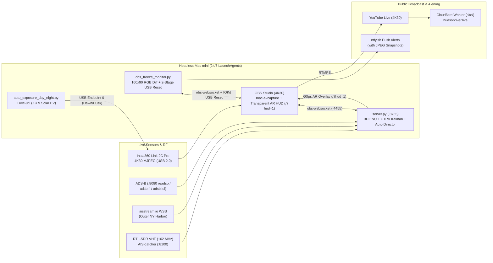

# Hudson River 24/7 AR Live Cam & Autonomous PTZ Director

A zero-dependency macOS broadcast stack powering **[hudsonriver.live](https://hudsonriver.live)** — a 24/7 4K30 YouTube Live stream overlooking Little Island, Pier 40, Lower Manhattan, and New York Harbor with real-time augmented-reality (AR) ship & aircraft tracking, solar-scheduled UVC hardware exposure, and self-healing camera monitoring.

Every Python service runs directly on macOS's built-in `/usr/bin/python3` (**Python 3.9+ standard library only — zero `pip install` packages required**).

---

## Architecture Overview



---

## Key Features

- **Photogrammetric 3D Geodesy & Pinhole Projection ([server.py](server.py)):**
  - Converts WGS84 `(lat, lon, altitude)` into local East-North-Up (ENU) coordinates, applying NYC's EGM2008 geoid undulation (`+33.0 m` / `+108.3 ft`) so geometric ADS-B altitudes align accurately with skyscrapers and water level.
  - Projects 3D positions and 3D velocity vectors through a calibrated camera pose (`azimuth`, `tilt`, `roll`, `HFOV`, radial barrel distortion `k1`) with exact analytical Jacobians `(du_s, dv_s)` for silky 60 fps browser velocity feed-forward.
  - Filters out targets occluded behind the Lower Manhattan or Jersey City/Hoboken skylines and suppresses Pier 40 steel-shed GPS multipath spikes on moored vessels.
- **Multi-Source ADS-B + VHF AIS Fusion ([server.py](server.py), [aisstream_client.py](aisstream_client.py)):**
  - Checks local 1090 MHz `readsb` (`127.0.0.1:8080`) first, automatically failing over across `adsb.fi`, `adsb.lol`, and `airplanes.live`.
  - Fuses zero-latency local 162 MHz VHF packets from `AIS-catcher` (`127.0.0.1:8100`) with `aisstream.io` static vessel profiles (names, hull lengths, destinations) and outer-harbor traffic.
  - Smooths tracks via an anisotropic 3D Constant-Turn-Rate & Velocity (CTRV) filter (tight along-track damping against timing jitter; responsive cross-track lateral turns).
- **Three Zero-Build Web Views ([static/index.html](static/index.html), [static/app.js](static/app.js)):**
  - `http://localhost:8765/` — **Mission Control:** Live OBS preview backdrop (pulled on-demand via [obs_camera_bridge.py](obs_camera_bridge.py); sleeps at 0% load when closed), ranked target queue, 3D landmark calibration pins, and manual click-to-slew PTZ controls.
  - `http://localhost:8765/?hud=1` — **Zero-Copy OBS AR HUD:** Transparent 60 fps HTML5 Canvas overlay composited directly over OBS's native 4K camera source.
  - `http://localhost:8765/?obs=1` — **Virtual 4K PTZ View:** Critically damped spring-damper digital zoom + broadcast lower-third chyron.
- **Cooperative Solar Exposure & Cloud-Aware Midday Dehaze ([auto_exposure_day_night.py](auto_exposure_day_night.py), [uvc_util.m](uvc_util.m)):**
  - Computes 3D solar elevation & azimuth (NOAA/Meeus model) to hold `+0.00 EV` baseline in daylight/golden hour, smoothly ramp `0.00 -> -1.80 EV` across civil twilight (`-1°` to `-6°`), and hold `-1.80 EV` overnight so pier floodlights never bloom, while keeping on-camera HDR disabled (`insta360-hdr=0`).
  - During sunny midday SSW window-glare hours (~`10:30 AM – 3:50 PM`), checks a `160x90` OBS camera histogram to distinguish clear-sky veiling glare from overcast clouds, and dials the camera's 12-bit hardware ISP (`exposure-comp-ev=-0.36`, `brightness=44`, `contrast=62`, `saturation=61` *before* MJPEG compression) to subtract milky window haze without crushing shadows or adding 8-bit sky banding.
  - Communicates cooperatively over USB Endpoint 0 without opening `AVCaptureSession`, and caches the kernel `IORegistry` USB `sessionID` + ISP registers so steady ticks generate **zero USB bus traffic**.
- **24/7 Freeze Monitor, Thermal Step-Down & 2-Stage USB Recovery ([obs_freeze_monitor.py](obs_freeze_monitor.py)):**
  - Captures tiny `160x90` lossless PNGs directly from OBS's raw `macos-avcapture` source every 10s (bypassing clock/HUD overlays) and decodes RGB pixels in pure Python to compute Mean Absolute Difference (`MAD`).
  - Enforces explicit `3840x2160 @ 30 fps MJPEG` (`NV12 / 420v`, `30000030/1000000`) in OBS so macOS `UVCAssistant` never falls into the buggy `H264` UVC mode.
  - Runs a quiet-first 2-stage auto-recovery (~30s detection -> ~5s heal) with rate-limited `ntfy.sh` summaries and immediate urgent alerts if recovery ever fails:
    1. **Stage 1:** Soft-cycles OBS's `AVCaptureSession` (`device: ""` -> restore).
    2. **Stage 2:** If the camera's USB bulk pipe (`0x81`) is hardware-stalled, escalates to `uvc-util --usb-reset` (`IOKit` `USBDeviceReEnumerate`), polling up to ~26s across firmware reboot.
    3. **Afternoon Solar Thermal Step-Down:** If ≥3 stalls occur within 20 minutes under direct afternoon window sunlight, automatically steps the camera down to `1080p30 MJPEG` (scaled seamlessly to fill the 4K canvas) for 60 minutes to cool the sensor before restoring native `4K30 MJPEG`.
- **Public Website on Cloudflare Workers ([site/](site/)):**
  - Serves `hudsonriver.live` and dynamically resolves the active YouTube Live broadcast ID via `/api/live` (edge-cached YouTube Atom feed parser using `HTMLRewriter`).

---

## Repository Structure

| Path | Description |
| :--- | :--- |
| [server.py](server.py) | Main HTTP + AR projection + CTRV Kalman filter + Auto-Director server (`:8765`) |
| [obs_camera_bridge.py](obs_camera_bridge.py) | On-demand OBS WebSocket v5 client (zero-load standby when Mission Control is closed) |
| [aisstream_client.py](aisstream_client.py) | Pure-stdlib RFC 6455 TLS WebSocket client & ship classifier for `aisstream.io` |
| [ptz_drivers.py](ptz_drivers.py) | Virtual PTZ, Sony/PTZOptics/FoMaKo VISCA-over-IP (UDP), and Axis VAPIX drivers |
| [calibration.json](calibration.json) | Camera geodetic coordinates, 3D orientation (`az`, `tilt`, `roll`, `hfov`, `k1`), and NYC skyline pins |
| [static/](static/) | Zero-build Mission Control UI, Virtual PTZ view (`?obs=1`), and OBS AR HUD (`?hud=1`) |
| [uvc_util.m](uvc_util.m) | Objective-C `IOKit` CLI for cooperative Insta360 XU exposure control & `--usb-reset` re-enumeration |
| [auto_exposure_day_night.py](auto_exposure_day_night.py) | Solar-elevation day/twilight/night UVC exposure controller (`live.hudsonriver.uvc-exposure`) |
| [obs_freeze_monitor.py](obs_freeze_monitor.py) | 24/7 pixel-diff freeze detector, `ntfy.sh` alerter & 2-stage recovery (`live.hudsonriver.obs-freeze-monitor`) |
| [vision_yolo_mac.py](vision_yolo_mac.py) | Optional Apple Silicon (`mps`) YOLOv11 tiled boat/aircraft visual spotter |
| [site/](site/) | Cloudflare Worker + static frontend powering `https://hudsonriver.live` |
| `*.command` | One-click macOS deployment & LaunchAgent installer scripts for the streaming Mac mini |

---

## Quickstart (Local Development)

1. **Configure optional environment variables:**
   ```bash
   cp .env.example .env
   # Edit .env to add AISSTREAM_API_KEY and NTFY_TOPIC if desired
   ```

2. **Run the AR & PTZ Director server (macOS built-in Python 3, zero dependencies):**
   ```bash
   python3 server.py
   ```
   - **Mission Control Dashboard:** `http://localhost:8765/`
   - **Transparent OBS AR Overlay:** `http://localhost:8765/?hud=1`
   - **Simulated PTZ Broadcast View:** `http://localhost:8765/?obs=1`

3. **Build the native `uvc-util` Objective-C tool (requires Xcode Command Line Tools):**
   ```bash
   clang -O2 -Wall -arch arm64 -arch x86_64 -framework Foundation -framework IOKit uvc_util.m -o uvc-util
   codesign -s - --force uvc-util
   ./uvc-util --probe
   ```

---

## Production 24/7 Mac mini Setup

On the dedicated headless Apple Silicon Mac mini, six `launchd` user agents keep the entire broadcast stack self-healing across reboots:

| LaunchAgent Label | Role |
| :--- | :--- |
| `local.keepawake.caffeinate` | Runs `caffeinate -di` + `NSAppSleepDisabled=YES` so macOS never throttles headless OBS rendering |
| `live.hudsonriver.obs` | Launches OBS Studio cleanly and streams 4K30 to YouTube Live |
| `live.hudsonriver.ais-catcher` | Decodes local 162 MHz VHF maritime AIS via RTL-SDR (`http://127.0.0.1:8100`) |
| `live.hudsonriver.ptz-server` | Runs [server.py](server.py) (`http://127.0.0.1:8765`) feeding OBS's `/?hud=1` Browser Source |
| `live.hudsonriver.uvc-exposure` | Runs [auto_exposure_day_night.py](auto_exposure_day_night.py) every 3 min for seamless dawn/dusk EV ramps |
| `live.hudsonriver.obs-freeze-monitor` | Runs [obs_freeze_monitor.py](obs_freeze_monitor.py) for `ntfy.sh` push alerts & 2-stage USB recovery |

### Deploying Updates to the Mac mini
- **Deploy PTZ / AR Server:** `./Deploy PTZ Server to Mac Mini.command`
- **Install / Update Solar Exposure Agent:** `./Install Mac Mini Auto Exposure.command`
- **Install / Update OBS Freeze Monitor:** `./Install OBS Freeze Monitor (Mac mini).command`

---

## Operational Notes & Hardware Lessons Learned

1. **Insta360 Link 2C Pro 4K30 `MJPEG` vs. `H264` on macOS:**
   - Over USB 2.0, the camera exposes two 4K30 stream descriptors to macOS `UVCAssistant`: `formatIndex 1` (`H264`, presented to OBS as `UYVY / 2vuy`) and `formatIndex 2` (`MJPEG`, presented to OBS as `NV12 / 420v`).
   - On macOS, `H264` (`Use Preset`) stalls every 4–16 minutes and can wedge bulk endpoint `0x81`, whereas explicit `3840x2160 @ 30 fps` `NV12 (420v)` (`MJPEG`, `frame_rate: 30000030/1000000`) streams 24/7 with zero stalls. [obs_freeze_monitor.py](obs_freeze_monitor.py) enforces this setting automatically.
2. **Headless macOS OBS Rendering Lag (App Nap):**
   - Without an attached display, macOS throttles OBS's background Metal render loop (~31% missed frames). Running `caffeinate -di` via `launchd` plus `defaults write com.obsproject.obs-studio NSAppSleepDisabled -bool YES` eliminates headless render lag (`0.00%` missed frames).
3. **West-Facing Window Solar Heating & On-Camera 4K HDR:**
   - Direct afternoon sunlight through window glass heats the matte-black aluminum camera housing; leaving on-camera dual-exposure HDR enabled (`insta360-hdr=1`) at 4K30 adds substantial ISP thermal load and can cause thermal pauses. Keeping `insta360-hdr=0` plus automatic 60-minute `1080p30 MJPEG` thermal step-down keeps the broadcast uninterrupted through peak sun.

---

## Deploying the Public Website (`site/`)

The [site/](site/) directory contains the Cloudflare Worker powering `hudsonriver.live`:

```bash
cd site
npm install
npx cf dev      # Local preview
npx cf deploy   # Deploy to Cloudflare Workers
```
